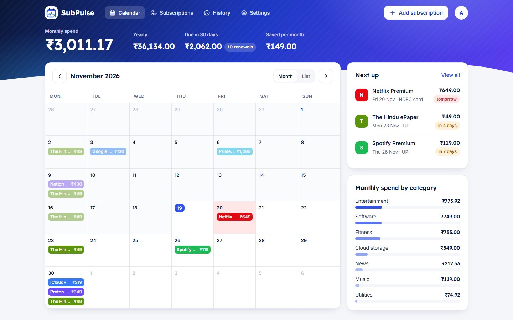
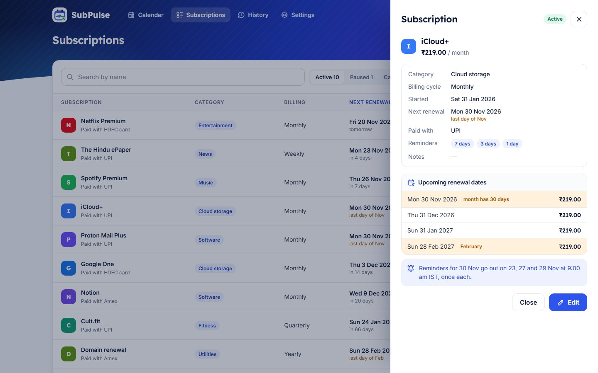

# SubPulse

[](https://github.com/Pavithiran21/SubPulse/actions/workflows/ci.yml)

A subscription tracker that warns you before you are charged. You keep every streaming, software, gym and cloud subscription in one place, see what you spend each month and year, and get an email a few days before each renewal, on the days you choose.

**Java 21 · Spring Boot 4 · MySQL 8.4 · Flyway · React 19 · TanStack Query · Tailwind CSS 4 · Playwright**



**What's hard here**

- **Month-end dates that don't drift.** A plan started on 31 January renews on 28 February, then 31 March again, because each renewal is worked out from a fixed anchor date instead of from the previous renewal ([RenewalSchedule.java](backend/src/main/java/com/subpulse/renewal/RenewalSchedule.java)).
- **One reminder per renewal, even when the job runs three times at once.** A reminder is claimed by inserting a row under `UNIQUE (subscription_id, renewal_date, days_before)`, and the claim commits before the email is sent ([ReminderService.java](backend/src/main/java/com/subpulse/reminder/ReminderService.java)).
- **"9 am" means the user's own 9 am.** Each user's today and send time are worked out in their own time zone, and a reminder for a day that has already passed is never sent late.



## Signature feature: correct renewal dates and reminders sent exactly once

A daily-style job (every 15 minutes, so every time zone reaches 9:00 local) calculates renewals and sends reminders. Two hard problems are solved in it.

**1. Month-end dates that don't drift.** A monthly plan started on **31 January** must renew on 28 or 29 February, then **31 March**, 30 April and 31 May. If each renewal were rolled forward from the previous one, the date would get stuck on the 28th after February. `RenewalSchedule` (`backend/src/main/java/com/subpulse/renewal/RenewalSchedule.java`) instead computes renewal *n* from a fixed **anchor date** (`anchor.plusMonths(n)`), so the 31st comes back. A yearly plan on 29 February renews on 28 February in common years. These are plain static functions with no clock and no database.

**2. One reminder per renewal, even with retries and overlapping runs.** `ReminderService` claims each reminder by inserting a row into `reminder_logs`, which has `UNIQUE (subscription_id, renewal_date, days_before)`. The claim **commits before the email is sent**. Exactly one run's insert wins; every other run gets MySQL error 1062 and counts a skipped duplicate. A failed send is marked `FAILED` and not retried, because the SMTP server may have accepted it. Each user's "today" and the 9:00 send time are worked out in their own time zone.

Each run is stored as a `job_runs` row with its counts (checked, sent, duplicates, renewals advanced, email failures). An external cron can also trigger it with `POST /api/internal/jobs/reminders` and the job secret.

## Features

- Register, log in, profile with time zone, currency and reminder days (7, 3, 1), password reset by email, delete my account
- Add, edit, pause, cancel, archive and delete subscriptions: weekly, monthly, quarterly or yearly
- Dashboard: monthly and yearly spend, spend by category, renewals in the next 30 days, with month-end dates marked
- Search, filter, sort and paginate the list; history of paused, cancelled and archived plans
- Money is `DECIMAL(12,2)` in MySQL and `BigDecimal` in Java, never floating point

## Roles

One role, **User**. Each user sees and changes only their own subscriptions. Another user's id answers 404.

## Tech stack

| Layer | Choice |
|-------|--------|
| Backend | Java 21, Spring Boot 4.1.2 (Web MVC, Security, Data JPA, Validation, Mail, Thymeleaf), Flyway, MySQL 8.4, JJWT, Bucket4j + Caffeine rate limits |
| Frontend | React 19, Vite 8, React Router 8, TanStack Query 5, React Hook Form + Zod, Tailwind CSS 4, Luxon, Tabler icons |
| Email | Any SMTP server: Ethereal for development, Brevo for real mail |

## Project structure

```
backend/src/main/java/com/subpulse/
  auth/           JWT access tokens, rotating refresh tokens (stored hashed), password reset
  subscription/   entity, controller, service, JPA specifications for filters
  renewal/        RenewalSchedule (the date maths) and the renewal preview
  reminder/       ReminderJob (scheduler), ReminderService (claim then send), job runs
  dashboard/  user/  mail/  demo/  health/
  common/         error format, validation, pagination, rate limiter, request ids
  seed/           seed-dev / seed-demo / seed-test profiles
backend/src/main/resources/
  application.yml, db/migration/V1__init.sql, templates/mail/
frontend/src/     api/ auth/ features/ components/ layout/ ...
```

## Run locally

**You need** Java 21 (Temurin), MySQL 8.4 and Node 26. Create the database once:

```powershell
mysql -u root -p -e "CREATE DATABASE subpulse"
```

Create `backend/.env`. It is read as a properties file, so write values **without quotes**.

| Variable | What it is |
|----------|------------|
| `DB_HOST`, `DB_PORT`, `DB_NAME`, `DB_USER`, `DB_PASSWORD` | MySQL connection (`127.0.0.1`, `3306`, `subpulse`, `root`, …) |
| `APP_ENV` | `development` or `production` |
| `PORT` | API port (4000) |
| `FRONTEND_URL` | `http://localhost:5173`, used in email links |
| `JWT_SECRET` | Signs access tokens (at least 32 characters) |
| `JOB_TRIGGER_SECRET` | Secret for the internal reminder-job endpoint |
| `RATE_LIMITS_ENABLED` | `true` (log-in and reset limits) |
| `DEMO_MODE` | `true` shows the demo log-in on the Log in page |
| `DEMO_PASSWORD` | Password given to the seeded dev and demo accounts |
| `REMINDER_CRON` | Reminder job schedule (`0 */15 * * * *`; `-` turns it off) |
| `JOB_TIME_OVERRIDE_ENABLED` | `true` lets the job run "as of" another moment; development only |
| `LOG_LEVEL` | Root log level |
| `SMTP_HOST`, `SMTP_PORT`, `SMTP_USER`, `SMTP_PASS`, `SMTP_FROM` | Outgoing mail |
| `DEMO_SMTP_HOST`, `DEMO_SMTP_PORT`, `DEMO_SMTP_USER`, `DEMO_SMTP_PASS` | Inbox for mail to `@demo.subpulse.test` addresses, so demo mail never goes to a real server |

Then:

```powershell
cd backend
.\mvnw.cmd -q -DskipTests package
# Seeds run once and exit. Flyway creates the tables on the first start.
java -jar target\subpulse-backend.jar --spring.profiles.active=seed-dev --spring.main.web-application-type=none
java -jar target\subpulse-backend.jar --spring.profiles.active=seed-demo --spring.main.web-application-type=none
java -jar target\subpulse-backend.jar       # API on http://localhost:4000

cd ..\frontend
npm ci
npm run dev                                  # app on http://localhost:5173 (Vite proxies /api)
```

The dev seed creates `dev@subpulse.test` with 13 subscriptions, including a monthly plan started on 31 January and a yearly one on 29 February.

### Or with Docker

```powershell
docker compose up --build
docker compose exec app java -jar /app/app.jar --spring.profiles.active=seed-demo --spring.main.web-application-type=none
# then open http://localhost:4000 and choose "Log in as User"
```

## Demo accounts

With `DEMO_MODE=true`, the Log in page offers **Log in as User**. The password is the one you set in `DEMO_PASSWORD`.

| Role | Email | What to try |
|------|-------|-------------|
| User | `user@demo.subpulse.test` | Look at the dashboard totals and the 30-day calendar, open iCloud+ (started 31 January) to see the month-end dates, add a quarterly plan, pause one. Blocked: opening another user's subscription by id gives "not found". |

Demo accounts cannot change their email or password or delete themselves.

## Testing

**Playwright only**, in [`e2e/`](e2e): API tests with Playwright's `request` client and browser tests, against a real MySQL 8.4 (`subpulse_test`) and a real Ethereal inbox. CI runs them on every push.

- **59 tests**: 40 API, 11 browser and 8 reminder-job tests.
- **Month-end dates:** a plan started on 31 January renews on the last day of each shorter month and on the 31st again; a yearly plan on 29 February renews on 28 February in common years; an edit that leaves the dates alone keeps the anchor.
- **Reminders sent exactly once:** the job is run three times and then three at once, and five overlapping runs claim one new reminder; exactly one email arrives in the inbox and the other runs count a duplicate. A reminder for a day that has passed is never sent late.
- **Time zones:** a user in Auckland gets "9 am" at 20:00 UTC the evening before, and nothing is sent before 09:00 local time or for a paused subscription.
- **Concurrency and rules:** two edits with the same version give one winner and one 409, ten pause requests at once pause the row once, another user's subscription answers 404 on every route, and the currency locks after the first subscription.
- **Money:** amounts are exact, yearly cost is the amount times the payments per year, and monthly is that divided by 12 and rounded once.
- **Email:** the password-reset mail is read from the Ethereal inbox over IMAP; the link works once, only the newest link works, and a reset logs the account out everywhere. The demo account's reminder goes to the demo inbox, never the main one.

The reminder-job tests run last and one at a time, because a job run looks at every user's subscriptions. "Now" is passed to the job endpoint (`JOB_TIME_OVERRIDE_ENABLED`, off in production), so the tests give the same result on any day.

```powershell
cd e2e
npm ci
npx playwright install chromium
npm test        # writes .env.test, creates and seeds subpulse_test, builds the jar, starts the API and app on their own ports, runs everything
```

## Deploy

One free [Render](https://render.com) web service from the `Dockerfile` (see [`render.yaml`](render.yaml)): Spring Boot serves the built frontend, so the app, the API and the refresh cookie share one origin, with no CORS or cross-site cookies. Flyway creates the tables on every start.

- **Database:** a hosted MySQL 8.4 such as Aiven's free plan. Create a `subpulse_demo` database and set `DB_*` and `SPRING_DATASOURCE_URL` (with `sslMode=REQUIRED`).
- **Settings:** `APP_ENV=production`, `SERVER_FORWARD_HEADERS_STRATEGY=native`, `DEMO_MODE=true`, `FRONTEND_URL` = the service URL, and SMTP for real mail (Brevo) plus `DEMO_SMTP_*` (Ethereal) for the demo account's mail.
- **Demo data:** run the `seed-demo` profile once from the service's Shell.
- **Reminders on a free plan:** a sleeping service runs no jobs, so point an external cron (for example cron-job.org, every 15 minutes) at `POST /api/internal/jobs/reminders` with the `X-Job-Secret` header.

Free services sleep after 15 minutes without traffic, so the first visit after that takes about a minute.

## Demo videos

- `SubPulse-full-workflow.webm`: sign-up, a plan started on 31 January with its month-end dates, the reminder job run three times and then three at once with each reminder sent once, the email and its link, and password reset
- `SubPulse-user-demo.webm`: the User role walkthrough

<!-- To embed: edit this README on GitHub and drag the .webm files from the workspace videos/ folder here. -->

## License

Copyright (c) 2026 R.Pavithiran. All rights reserved. The source is public so you can read it and see how it is built. Please ask before copying, reusing or redistributing it.
